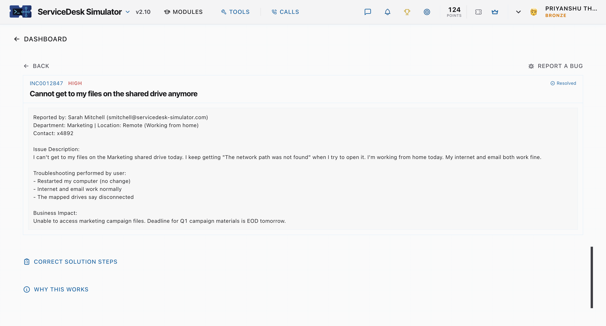

# INCIDENT TICKET: #INC0012847
**Priority:** High
**User:** Sarah Mitchell (Marketing)
**Location:** Remote (Working from home)
**Issue Reported:** "I can't get to my files on the Marketing shared drive today. I keep getting 'The network path was not found' when I try to open it... The mapped drives say disconnected."
**Business Impact:** Unable to access marketing campaign files. Deadline for Q1 campaign materials is EOD tomorrow.

---

### 1. Identify the Problem
* **Symptoms:** Remote user cannot access mapped network drives. System returns a "network path not found" error.
* **Environment:** User is working from home. 
* **User Actions Performed:** User restarted the computer with no change. User verified local internet and cloud email are functioning normally.

### 2. Establish a Theory of Probable Cause
* Because the user is remote but internet and cloud-based email work fine, the local internet connection is healthy.
* On-premises shared network drives require a secure tunnel to the corporate Local Area Network (LAN).
* **Theory:** The user's corporate VPN (Virtual Private Network) client is either disconnected, timed out, or failing to route traffic properly (split-tunneling issue).

### 3. Test the Theory & Implement Plan of Action
* Contacted the user and asked them to check their system tray/menu bar for the VPN client icon. 
* User confirmed the VPN application was not actively connected.
* Guided the user to open the corporate VPN client, authenticate using their domain credentials, and approve the Multi-Factor Authentication (MFA) prompt.

### 4. Verify Full System Functionality
* Once the VPN tunnel was established, instructed the user to open File Explorer / Finder.
* User clicked on the mapped Marketing drive; it successfully connected and displayed the campaign files.
* **Preventive:** Reminded the user that a VPN connection is always required when working from home to access internal servers.

### 5. Document Findings
* **Root Cause:** Corporate VPN was not connected, preventing access to the internal network and mapped drives.
* **Resolution:** Guided user through launching and authenticating the VPN client. Verified file access.
* **Status:** RESOLVED
