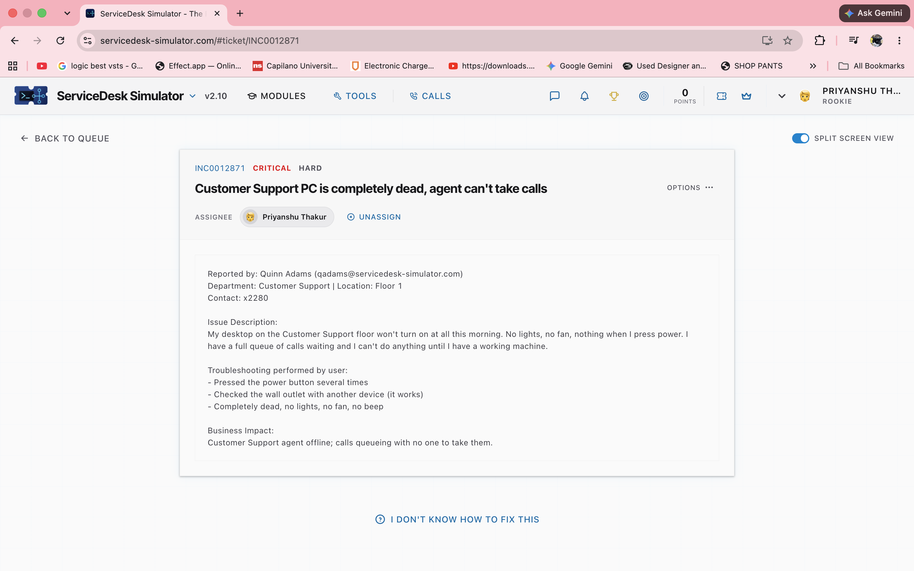
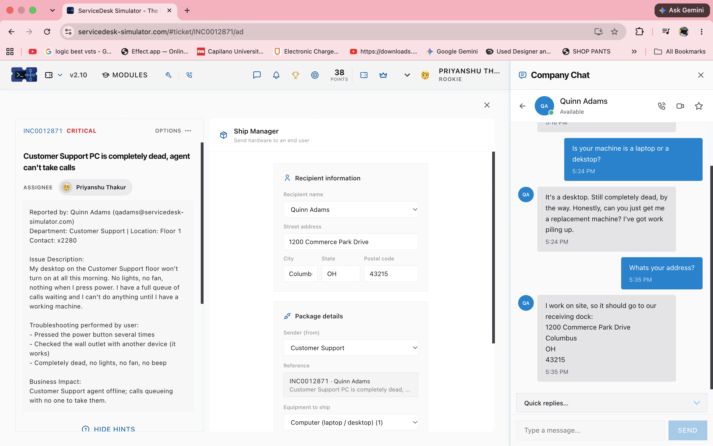

# INCIDENT TICKET: #INC0012871
**Priority:** Critical
**User:** Quinn Adams (Customer Support)
**Issue Reported:** Customer Support PC is completely dead. 

---

### 1. Triage and Plan of Action
* User reported a completely dead desktop workstation (no POST, no fan spin).
* Due to the critical business impact (calls queueing), physical bench diagnostics were bypassed in favor of immediate hardware replacement.

* Contacted the user via Company Chat to confirm device type (desktop) and acquire their exact shipping address.

### 2. Implement Hardware Replacement
* Accessed the IT Asset Management "Ship Manager" module.
* Configured an expedited shipment for a replacement Computer (desktop) from the IT Department to Quinn Adams at 1200 Commerce Park Drive, Columbus, OH 43215.

### 3. Document Findings
* **Resolution:** Replacement desktop provisioned and shipped to the user's location to minimize downtime. 
* **Status:** RESOLVED
