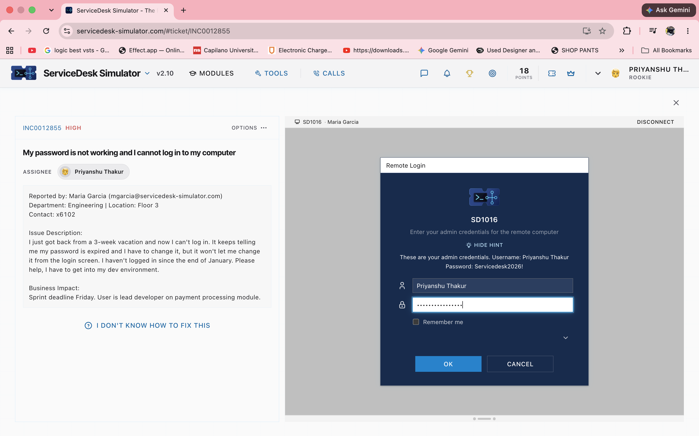
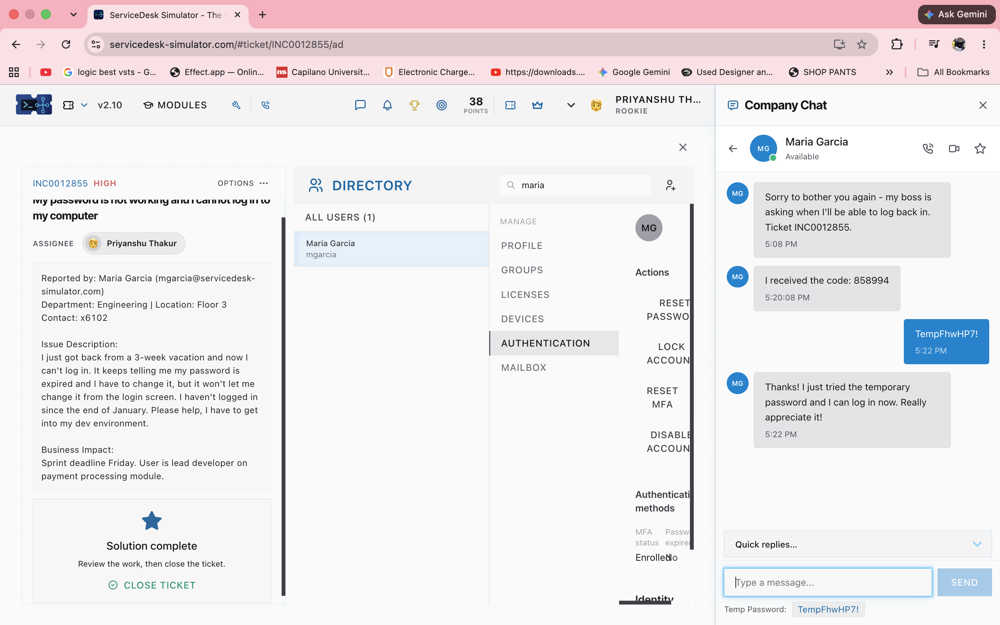

# INCIDENT TICKET: #INC0012855
**Priority:** High
**User:** Maria Garcia (Engineering, Floor 3)
**Issue Reported:** "I just got back from a 3-week vacation and now I can't log in. It keeps telling me my password is expired and I have to change it, but it won't let me change it from the login screen."
**Business Impact:** User is lead developer on a payment processing module; Sprint deadline is Friday.

---

### 1. Identify the Problem
* **Symptoms:** User is locked out of their development environment due to an expired password.
* **Environment:** Remote connection required to access the user's local machine or domain controller.

### 2. Establish a Theory of Probable Cause
* The Active Directory password policy enforced a password expiration while the user was on leave.
* The user's account may be temporarily locked due to too many failed login attempts with the old password.

### 3. Test the Theory & Implement Plan of Action
* Initiated a Remote Login session using admin credentials to access the user's environment.

* Accessed the Directory management module to verify the account status.
* Triggered a password reset for Maria Garcia's account.

### 4. Verify Full System Functionality
* Generated a temporary password (`TempFhwHP7!`).
* Communicated with the user via the Company Chat portal to securely deliver the temporary password and confirm access.

* User confirmed successful login. 

### 5. Document Findings
* **Root Cause:** Password expired during extended leave.
* **Resolution:** Reset password via remote support tools and verified user access.
* **Status:** CLOSED
