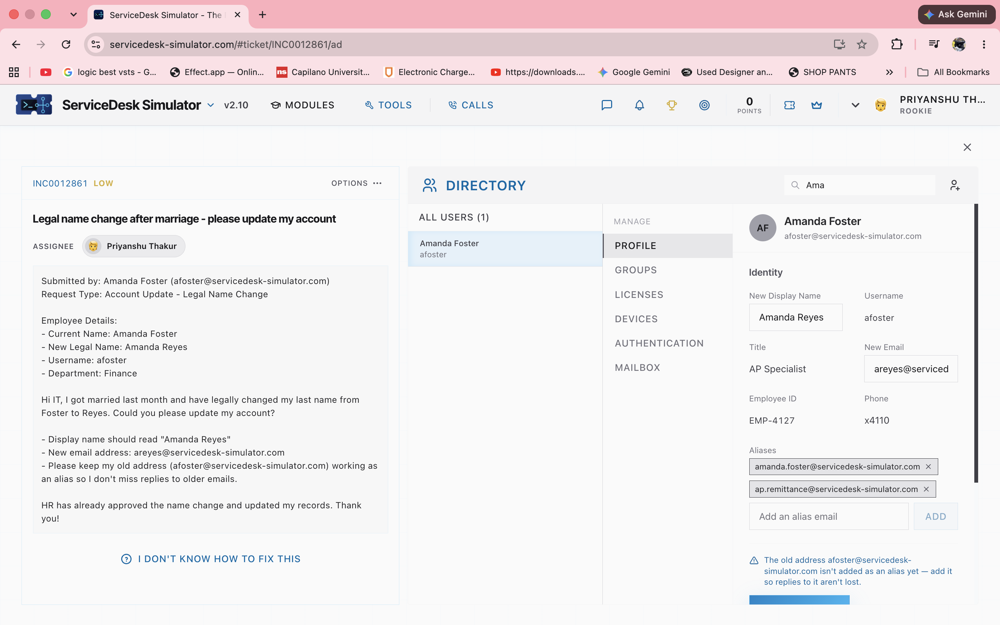

# INCIDENT TICKET: #INC0012861
**Priority:** Low
**User:** Amanda Foster (Finance)
**Issue Reported:** Legal name change after marriage. Requesting account update to "Amanda Reyes".

---

### 1. Identify the Request
* **Requirement:** Update Active Directory display name and email address to reflect a legal name change, approved by HR.
* **Constraint:** Must retain the old email address to ensure no communications are lost.

### 2. Implement Plan of Action
* Navigated to the Active Directory Identity Management console.
* Updated **New Display Name** to `Amanda Reyes`.
* Updated **New Email** to `areyes@servicedesk-simulator.com`.
* Added the previous email (`amanda.foster@servicedesk-simulator.com`) to the **Aliases** list to route legacy emails to the new inbox.

### 3. Verify & Document
* Verified all alias fields were populated correctly before saving the profile.
* **Resolution:** AD profile successfully migrated to new legal name with email aliases configured. 
* **Status:** CLOSED
